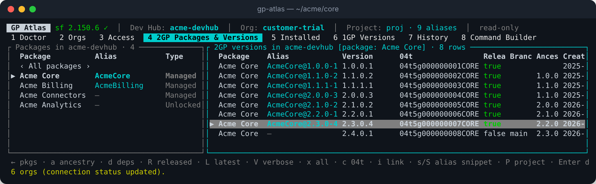

# GP Atlas

*Browse 1GP and 2GP package versions and build `sf` commands, from a clickable
terminal app.*

GP Atlas runs in your terminal next to the Salesforce CLI. It shows the
packages and versions of your Dev Hubs and orgs, what each org lets you read,
how versions are related, and builds exact `sf` commands for you to copy. It
uses your installed `sf` as its only data source and is **read-only**: it
never changes an org.



> **Not affiliated with or endorsed by Salesforce.** Salesforce and related
> marks are trademarks of Salesforce, Inc.

**Documentation: <https://holapancho.github.io/gp-atlas/>** (also readable in
[`docs/`](docs/index.md)).

## Install

Requires the Salesforce CLI **2.150.6 or newer** (`sf version`).

macOS / Linux:

```bash
curl -fsSL https://raw.githubusercontent.com/holapancho/gp-atlas/main/install.sh | sh
```

Windows PowerShell:

```powershell
irm https://raw.githubusercontent.com/holapancho/gp-atlas/main/install.ps1 | iex
```

With Rust instead:

```bash
cargo install --locked --git https://github.com/holapancho/gp-atlas gp-atlas-tui gp-atlas-cli
```

Then run `gp-atlas`. Other ways (manual download, clone and build) are in
[Install](docs/install.md); a debug build for testers is in
[Beta testing](docs/beta-testing.md).

## Features

- **Doctor**: checks `sf`, its version, the packaging plugin and every command's flags.
- **Orgs** and the **Access Matrix**: what each org lets you read, why not, and a fix to copy.
- **2GP packages & versions**: released / latest per package, details, copy 04t or install link.
- **Ancestry** tree and **dependencies** in install order, checked against the selected org.
- **Installed packages** and **1GP versions**, with filters for long lists.
- **Project aliases** from `sfdx-project.json` (read-only), with warnings and ready-to-paste entries.
- **Command Builder**: every read-only command as a validated form, quoted for bash/zsh, PowerShell or cmd; copy or run.
- **History** of every `sf` call; `c` or right-click copies any ID.

Keys and screens: [User guide](docs/guide.md).

## Read-only guarantee

GP Atlas can only run a fixed list of read-only `sf` commands. It never
creates, promotes, deletes, installs, converts or schedules anything, never
logs in or out, never changes the CLI configuration or aliases, never runs
`sf org display`, never reads auth files, and never stores tokens or
installation keys. It makes no network calls of its own.

## Project

- [Roadmap](ROADMAP.md): what comes next.
- [Changelog](CHANGELOG.md).
- [Development](docs/development.md): building, tests, CI, releasing.
- [SPEC.md](SPEC.md): the full specification.

## License

[MIT](LICENSE).
